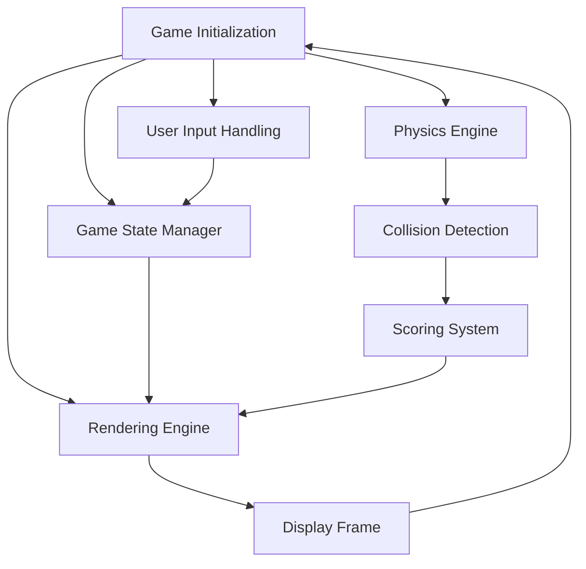

# Flappy Bird [](https://www.python.org/downloads/release/python-3100/) [](https://www.pygame.org/news) [](LICENSE) [](https://example.com/demo-link)

## Executive Summary
Flappy Bird is a classic side-scrolling game brought to life with Python and Pygame. This repository is a modernized take on the arcade favorite, offering modular game architecture, customizable game mechanics, and opportunities for developers to learn or expand their knowledge of Python-based 2D game development.

---

## Key Features
- **Modular Design:** Rendering, input handling, physics, collision detection, and scoring are separated into clear, maintainable modules.
- **Customizable Gameplay:** Easily tweak gravity, pipe spacing, bird speed, and other parameters to suit various difficulty levels or experimentation.
- **Deterministic Unit Tests:** Includes robust tests for collision detection, scoring logic, procedural pipe generation, and game-state transitions.
- **Cross-Platform Playability:** Runs seamlessly on Windows, macOS, and Linux.
- **Pinned Dependencies:** Ensures compatibility and stability with Python 3.10+ and Pygame 2.1.3.
- **Asset Attribution:** All included assets are licensed and properly documented for open-source reuse.
- **Scalable:** Readily extendable to support challenge modes, multiplayer, or additional gameplay features.

---

## Architecture & Workflow
The game architecture is designed for clarity, maintainability, and extensibility. Below is a high-level flowchart of the main components:



### Modular Breakdown
- **Rendering Engine:** Responsible for displaying the bird, pipes, background, and score.
- **Input Handling:** Processes user inputs such as spacebar or touchscreen taps.
- **Physics Engine:** Implements gravity, acceleration, velocity, and other movement mechanics.
- **Collision Detection:** Handles interactions like bird-pipe and bird-ground collisions.
- **Game State Manager:** Tracks game phases (start, in-progress, game-over).
- **Scoring System:** Updates and renders the player's score based on successful pipe crossings.

---

## Tech Stack & Tools
- **Languages:** Python 3.10+
- **Framework:** Pygame 2.1.3 (for game development)
- **Testing Framework:** `pytest` for unit testing
- **Dependency Management:** `pip` with a locked `requirements.txt`

---

## Quickstart / Installation
Follow these steps to clone, set up, and play the game locally:

1. **Clone the Repository:**
   ```bash
   git clone https://github.com/EF361/flappy-bird.git
   cd flappy-bird
   ```

2. **Setup the Virtual Environment (Optional):**
   ```bash
   python -m venv venv
   source venv/bin/activate  # On Windows: venv\Scripts\activate
   ```

3. **Install Dependencies:**
   ```bash
   pip install -r requirements.txt
   ```

4. **Run the Game:**
   ```bash
   python main.py
   ```

---

## Contributing
We welcome contributions from developers of all expertise levels. Please follow these general guidelines:
1. Fork the repository and create a feature branch (`feature/new-feature`).
2. Write modular, well-documented code aligned with the project architecture.
3. Add appropriate unit tests for any new functionality.
4. Submit a pull request detailing your changes and their purpose.

---

## Screenshots


---

## Roadmap
### Completed Features:
- Procedural pipe generation
- Gravity-based movement & score tracking
- Game-over logic and event-driven state transitions

### Upcoming Features:
- Multiplayer support
- Pixel-perfect physics modes
- Advanced challenge settings (e.g., moving pipes)
- Mobile-friendly touchscreen inputs

---

## Asset Licensing
All game assets (sprites, background images, sound effects) are licensed under [Creative Commons](https://creativecommons.org/licenses/) or equivalent open-source licenses. Attribution is listed in `ASSETS.md`.

---

## License
This project is released under the [MIT License](LICENSE), allowing free, open-source use, modification, and distribution.

---

**Developed and maintained by [Alicia Goh](https://github.com/EF361)**, a passionate software engineer specializing in scalable, modular Python applications.