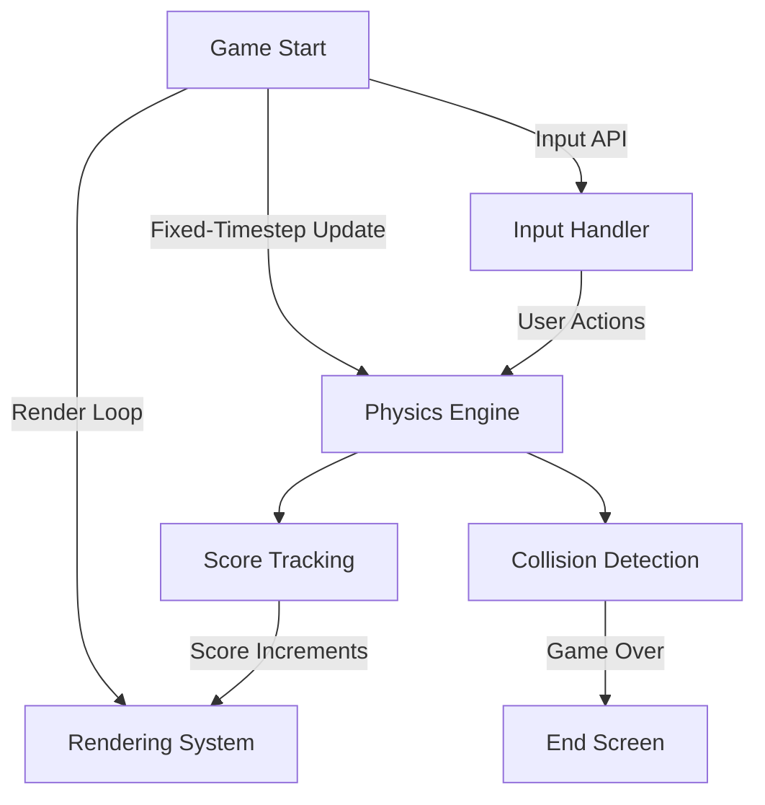

# Flappy Bird - A Modern Python Implementation  
    [](https://your-demo-url.com)  

---

## 🐦 Executive Summary  
Flappy Bird is an educational and modern reimplementation of the popular arcade game, built using Python and Pygame. The project demonstrates clean coding principles, modular design, scalable architecture, and an emphasis on deterministic behavior for consistent cross-platform gameplay.

---

## 🌟 Key Features  
- **Deterministic Physics:** Fixed-timestep update loop ensures smooth and consistent gameplay across devices.  
- **Headless Simulation-Friendly:** Game logic operates independently of rendering and input, enabling precise tests for edge cases, e.g., collision or score transitions.  
- **Thorough Testing Coverage:** Includes tests for critical mechanics: collision boundaries, score progression, restarts, seeded pipe generation, pause/focus loss, and extreme frame delays.  
- **Optimized Assets:** Image/audio files compressed for reduced size with attribution tracked in [ASSETS.md](ASSETS.md).  
- **Cross-Version Compatibility:** Supports Python 3.10+ and Pygame 2.1.3, validated with CI pipelines.  
- **Continuous Integration (CI):** Robust headless testing via GitHub Actions ensures reliability and compatibility.  
- **Configurable Game Settings:** Provides flexibility to adjust bird speed, gravity strength, pipe generation timing, etc.

---

## 🔧 Architecture & Workflow  



- **Rendering System:** Handles graphics, animations, and screen updates.  
- **Input Handler:** Processes user input without blocking the main game loop.  
- **Physics Engine:** Simulates consistent gravity and bird motion independent of frame rate.  
- **Collision Detection:** Manages interactions between the bird, pipes, and ground.  
- **Score Tracking:** Implements scoring logic triggered by pipe passages.  

---

## 🛠️ Tech Stack & Tools  
- **Programming Language:** Python 3.10+  
- **Game Framework:** Pygame 2.1.3  
- **Testing Framework:** pytest  
- **Build & CI:** GitHub Actions (headless simulations and multi-version testing)  
- **Asset Optimization:** Image/audio compression tools for reduced repository size.  

---

## 🚀 Quickstart / Installation  

1. **Clone The Repository:**  
   ```bash
   git clone https://github.com/EF361/flappy-bird.git
   cd flappy-bird
   ```

2. **Create and Activate a Virtual Environment:**  
   ```bash
   python -m venv env
   source env/bin/activate   # On Windows: .\env\Scripts\activate
   ```

3. **Install Dependencies:**  
   ```bash
   pip install -r requirements.txt
   ```

4. **Run the Game:**  
   ```bash
   python flappy_bird.py
   ```

5. **Run Tests (Optional):**  
   ```bash
   pytest
   ```

6. **Live Demo:**  
   Play the game [here](https://your-demo-url.com).

---

## 📜 Asset Attribution  
All images, sounds, and other external assets are attributed in [ASSETS.md](ASSETS.md). Assets comply with licensing requirements, ensuring legal and ethical usage.

---

## 👩‍💻 About the Author  

Crafted by **Alicia Goh (EF361)**, a distinguished AI & Software Engineer specializing in clean-code design, performant architecture, and collaborative open-source contributions. Connect with Alicia on [LinkedIn](https://linkedin.com/in/alicia-goh) or check out her [GitHub page](https://github.com/EF361).  

---