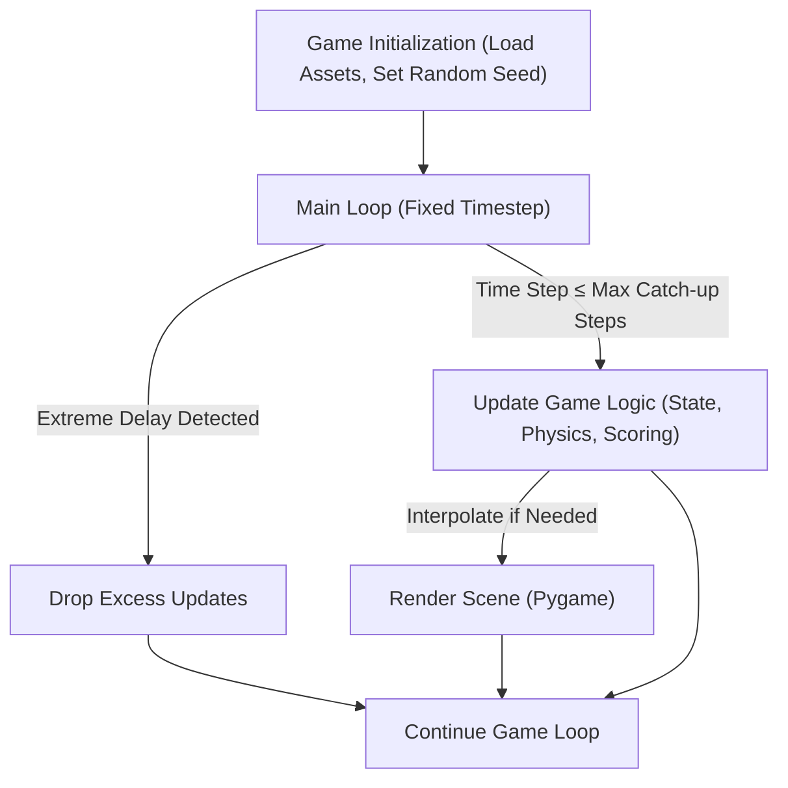

# Flappy Bird      

## Executive Summary  
Flappy Bird is a modern, educational take on the iconic 2D arcade game. Designed for both developers and gaming enthusiasts, this project demonstrates advanced game engineering principles, including fixed-timestep simulation, deterministic randomness, and robust CI testing, making it a powerful learning tool for real-time game mechanics in Python.  

## Key Features  
- **Fixed-timestep Simulation**: Ensures consistent gameplay across different hardware and frame rates, with interpolation for smooth rendering.
- **Deterministic State Management**: Keeps simulation independent of wall-clock time, rendering, audio, and raw input, enabling reliable debugging and unit testing.
- **Automated Testing Suite**: Includes tests for collision detection, scoring updates, pipe generation (with seeded randomness), and gameplay restart mechanics.
- **Optimized Assets**: Image and audio files are compressed for performance without compromising quality. Full asset source and licensing are documented in [ASSETS.md](ASSETS.md).
- **Headless CI Integration**: Supports Python 3.10+ and Pygame 2.1.3 across various configurations through GitHub Actions, ensuring compatibility and reliability.  
- **Educational Codebase**: Approachable code structure for learning real-time physics, input management, and modular game design in Python.  

## Architecture & Workflow  
Flappy Bird follows a clean separation of concerns to handle simulation, input, rendering, and audio independently and efficiently.  



### Core Concepts:
1. **Fixed Timestep**: Capable of handling extreme delays with a maximum catch-up limit to prevent simulation spiraling.
2. **Interpolation Policy**: Smooth in-between frame rendering to counterbalance low-performance spikes.
3. **Deterministic Engine**: Ensures reproducible states for debugging or multiplayer desynchronization checks.
4. **CI Pipeline**: Runs automated headless tests to cover edge cases continuously.

## Tech Stack & Tools Breakdown  
- **Python 3.10+**: Core programming language for its robust ecosystem and ease of learning.  
- **Pygame 2.1.3**: Framework for building the game's 2D interface, handling inputs, and rendering.  
- **pytest**: Testing framework for ensuring stability across all components (state, scoring, collision, and restart).  
- **GitHub Actions**: Implements headless CI/CD pipelines to verify game logic on supported Python and Pygame versions.  
- **Image & Audio Assets**: Assets are optimized and fully documented in [ASSETS.md](ASSETS.md) for transparency.  

## Quickstart / Installation  

### Requirements  
- Python 3.10 or higher  
- Pygame 2.1.3 or higher  
- Compatible operating system (Windows/Mac/Linux)  

### Repository Setup  
Clone the repository and set up your environment:  
```bash
git clone https://github.com/EF361/flappy-bird.git
cd flappy-bird
python -m venv venv
source venv/bin/activate  # On Windows: venv\Scripts\activate
pip install -r requirements.txt
```

### Run the Game  
Launch the game with:  
```bash
python main.py
```

### Run Tests  
To validate the game logic and ensure robustness, use:  
```bash
pytest
```

### Demo  
A live demo is currently unavailable. Feel free to explore locally and contribute improvements!  

## Contributing  
We welcome contributions to improve the game and its learning value. Please review the [CONTRIBUTING.md](CONTRIBUTING.md) guidelines to get started.  

---  

Developed by **Alicia Goh (EF361)**, demonstrating software engineering excellence through a balance of clean architecture, innovation, and educational coding practices.