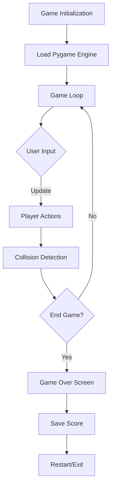

# Flappy Bird Clone 🚀 [](https://www.python.org/) [](https://www.pygame.org/) [](./LICENSE) [](https://github.com/EF361/flappy-bird)

## Executive Summary
Flappy Bird Clone is a modern recreation of the iconic game, designed to entertain and educate aspiring developers. Built with Python and Pygame, it’s a lightweight, fully customizable platform for gaming enthusiasts and software learners alike. This repository empowers developers to master game mechanics, while extending gameplay through creative improvements.

---

## Key Features
- **Classic Gameplay Mechanics**: A seamless, pixel-perfect recreation of the original Flappy Bird experience.
- **Extensible Game Design**: Modular, well-documented codebase to simplify contribution and experimentation.
- **Multiplayer-Ready Architecture** _(Planned Feature Update)_: Envisioned support for online/local competitive leaderboard matches.
- **Challenge Modes**: Customizable difficulty levels and obstacle variations to elevate engagement.
- **Rich Developer Insights**: Includes best practices for Pygame development and community-driven extensions.

---

## Architecture & Workflow



---

## Tech Stack & Tools Breakdown
- **Programming Language**: [Python 3.10+](https://www.python.org/)
- **Game Library**: [Pygame 2.1.3](https://www.pygame.org/)
- **Development Setup**: Cross-platform compatibility (Windows, macOS, Linux)
- **Version Control**: [Git](https://git-scm.com/) for organizing contributions and collaboration
- **Build Automation**: Easy run with `pip` for dependency management

---

## Quickstart / Installation

1. **Clone the Repository**:
   ```bash
   git clone https://github.com/EF361/flappy-bird.git
   cd flappy-bird
   ```

2. **Set Up a Virtual Environment** (Optional but recommended):
   ```bash
   python -m venv venv
   source venv/bin/activate   # On Windows: venv\Scripts\activate
   ```

3. **Install Dependencies**:
   ```bash
   pip install -r requirements.txt
   ```

4. **Run the Game**:
   ```bash
   python flappy_bird.py
   ```

5. **Enjoy and Contribute**:
   Modify the code or share issues/pull requests with the community to extend this project further!

---

## Community Contribution & Roadmap
We aspire to make this project a collaborative success. Here's what we're working on:
- Adding **multiplayer mode** for live competitive play.
- Introducing **adaptive challenges** for varying player skills.
- Optional **AI-powered gameplay demos** as reference points.

Feel free to open a discussion thread or suggest enhancements via GitHub issues. Together, we can build something extraordinary!

---

**Author**: [Alicia Goh (EF361)](https://github.com/EF361)  
_A passionate AI & Software Engineer exploring boundary-pushing solutions in gaming architecture._